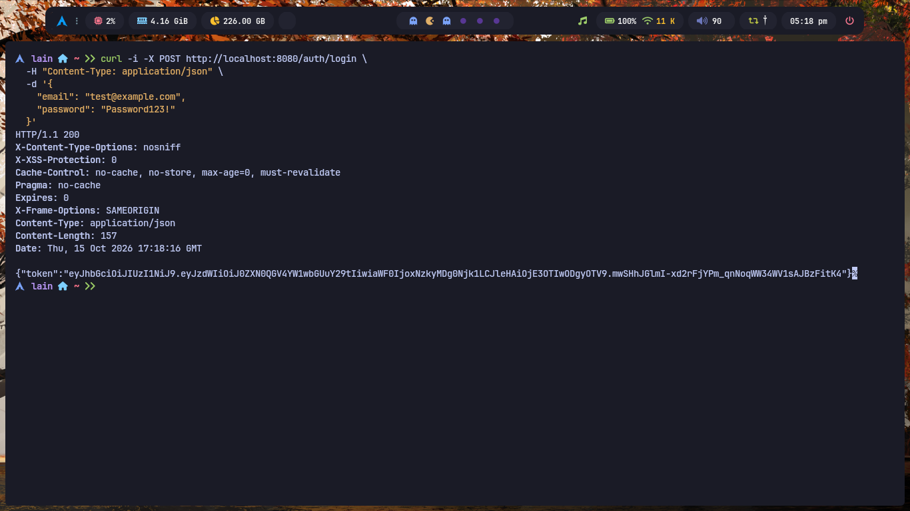
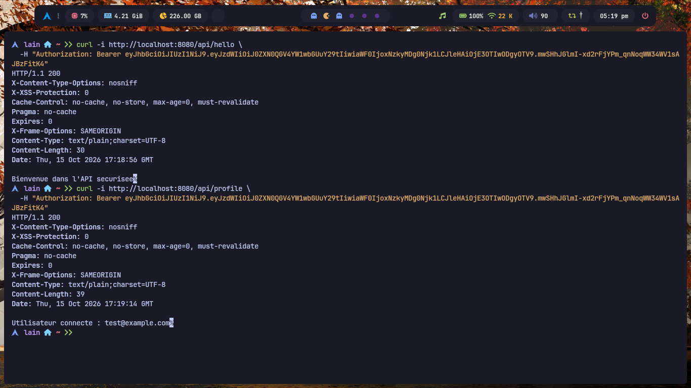
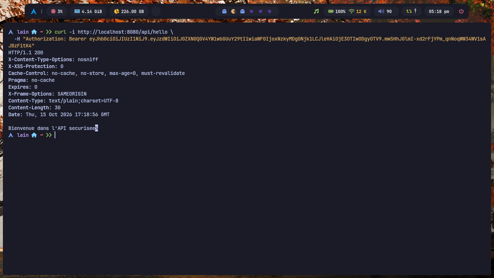
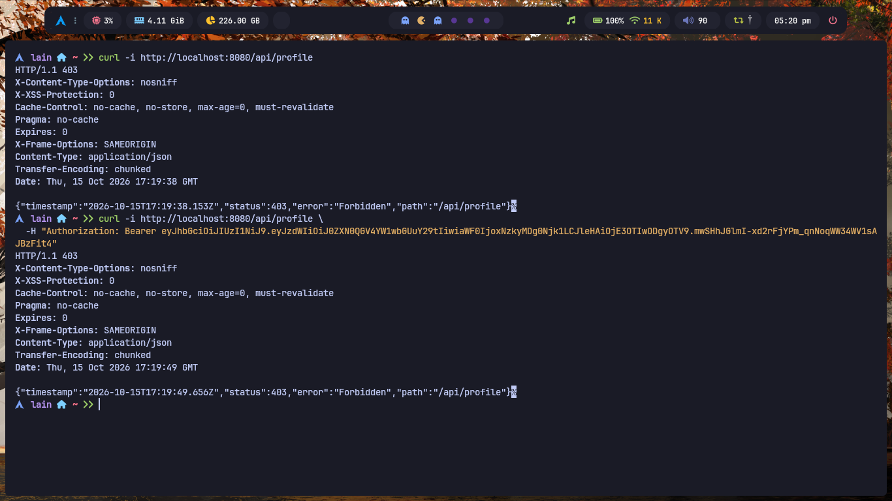

# Application de sécurité Spring Boot avec JWT

## Présentation

Ce projet consiste à développer une API REST sécurisée avec **Spring Boot et Spring Security**, en utilisant l'authentification par JSON Web Token (JWT).

L'application permet d'inscrire des utilisateurs, de les authentifier et de protéger des endpoints grâce à un token JWT.

## Fonctionnalités

- Inscription des utilisateurs.
- Connexion avec email et mot de passe.
- Hachage des mots de passe avec BCrypt.
- Génération et validation des tokens JWT.
- Authentification stateless avec Spring Security.
- Protection des endpoints REST.
- Utilisation d'une base de données H2.

## Technologies utilisées

- Java 21
- Spring Boot
- Spring Security
- Spring Data JPA
- H2 Database
- JWT avec JJWT 0.12.6
- Maven

## Structure du projet

```text
src/main/java/ma/enset/jwt_security_tp/
├── controller/
│   ├── AuthController.java
│   └── UserController.java
├── dto/
├── entity/
├── repository/
├── security/
│   ├── JwtFilter.java
│   └── SecurityConfig.java
└── service/
    ├── CustomUserDetailsService.java
    └── JwtService.java
```

## Installation et lancement

### Prérequis

- JDK 21
- Maven
- Git

### 1. Cloner le dépôt

```bash
git clone https://github.com/VOTRE_NOM/jwt-security-tp.git
cd jwt-security-tp
```

### 2. Configurer le secret JWT

Générer un secret Base64 :

```bash
openssl rand -base64 32
```

Configurer les propriétés dans `src/main/resources/application.properties` :

```properties
spring.application.name=jwt-security-tp

spring.datasource.url=jdbc:h2:mem:securitydb
spring.datasource.driverClassName=org.h2.Driver
spring.datasource.username=sa
spring.datasource.password=

spring.jpa.hibernate.ddl-auto=update
spring.jpa.show-sql=true

spring.h2.console.enabled=true
spring.h2.console.path=/h2-console

jwt.secret=VOTRE_SECRET_BASE64
jwt.expiration=3600000
```

Remplacer `VOTRE_SECRET_BASE64` par le secret généré. Ne jamais publier un véritable secret dans un dépôt public.

### 3. Lancer l'application

```bash
mvn spring-boot:run
```

L'application sera accessible à l'adresse `http://localhost:8080`.

## Endpoints de l'API

| Méthode | Endpoint | Description | Accès |
|---|---|---|---|
| POST | `/auth/register` | Inscription d'un utilisateur | Public |
| POST | `/auth/login` | Connexion et génération du JWT | Public |
| GET | `/api/hello` | Message de bienvenue | JWT requis selon la configuration actuelle |
| GET | `/api/profile` | Informations sur l'utilisateur connecté | JWT requis |

## Tests avec cURL

### 1. Inscription

```bash
curl -i -X POST http://localhost:8080/auth/register \
  -H "Content-Type: application/json" \
  -d '{"email":"test@example.com","password":"Password123!"}'
```

### 2. Connexion

```bash
curl -i -X POST http://localhost:8080/auth/login \
  -H "Content-Type: application/json" \
  -d '{"email":"test@example.com","password":"Password123!"}'
```

La réponse contient un token JWT à envoyer lors des requêtes protégées.

### 3. Accès au profil avec un token

```bash
curl -i http://localhost:8080/api/profile \
  -H "Authorization: Bearer VOTRE_TOKEN"
```

### 4. Accès sans token

```bash
curl -i http://localhost:8080/api/profile
```

La requête doit être refusée, car le profil nécessite une authentification.

## Captures d'écran

### 1. Inscription d'un utilisateur


### 2. Tentative d'inscription avec une adresse déjà utilisée


### 3. Connexion et génération du JWT



### 4. Accès au profil de l'utilisateur connecté



### 5. Message de bienvenue de l'API



### 6. Accès refusé sans authentification



## Base de données H2

Le projet utilise une base de données H2 en mémoire.

Console H2 : `http://localhost:8080/h2-console`

Paramètres de connexion :

- **URL JDBC :** `jdbc:h2:mem:securitydb`
- **Utilisateur :** `sa`
- **Mot de passe :** vide

Les données sont supprimées à l'arrêt de l'application.

## Fonctionnement de la sécurité

1. L'utilisateur s'inscrit avec son email et son mot de passe.
2. Le mot de passe est haché avec BCrypt avant d'être enregistré.
3. Lors de la connexion, Spring Security vérifie les identifiants.
4. Un token JWT est généré après une authentification réussie.
5. Le client envoie le token dans l'en-tête HTTP `Authorization`.
6. Le filtre `JwtFilter` valide le token et établit l'authentification.
7. Spring Security contrôle l'accès aux endpoints protégés.

## Auteur

ETTALEBY M'barek

Master SDIA — ENSET Mohammedia

## Licence

Projet réalisé dans un cadre pédagogique.
